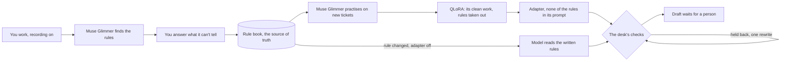
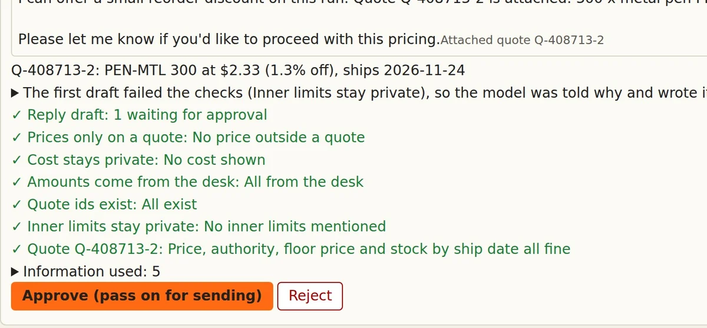

# workalike

[](https://github.com/Flyingrang2/workalike/actions/workflows/check.yml)
[](LICENSE)

**The agent that learns the rules nobody wrote down.**

workalike finds them in how you work, asks you only what it can't tell, and trains them into an open Muse Glimmer model that stays on your own GPU.

In our test on a sample desk, with no rules in its prompt: 0.91% off a pushback where the base model gave 4.94%, a question where it made up a ship date, and about five times the tickets on one GPU, at 41 of 48 right against 45 reading the rules.

- **See it in your browser, about a minute, nothing to install:** https://flyingrang2.github.io/workalike/ (one request handled three ways on the same model and GPU: the real recorded runs, played together and sped up)
- **Watch the three-minute film:** https://youtu.be/nrKQsbhO6Go
- **Download the LoRA, 419 MB, free:** [latest release](https://github.com/Flyingrang2/workalike/releases/latest)
- **Check the numbers yourself, no GPU:** [three commands](#check-it-without-a-gpu) and the [evidence page](https://flyingrang2.github.io/workalike/evidence.html)

> **Built solo during the Meta Global AI Developer Hackathon.** There is no earlier codebase. The first commit is from October 27, 2026. The public history is squashed into seven stages, each dated at its last commit, and later fixes follow them. [Commits per day](baselines/results/original-commits-per-day.txt) are listed, and the full commit-by-commit log is available to the organizers on request.

## The problem

I run a one-person startup, and the work is different every time. When I hand a job to someone else, it rarely goes the way I want, so I end up doing it myself. I wanted someone who works like me when I'm not there, and that is why I built workalike.

Then I timed myself against it, by hand, on [one ticket from the test](baselines/results/person-time/results.jsonl): 3 minutes 23 seconds, and my reply had no quote. The LoRA took 31 seconds and got it right, and across all 48 test runs it averaged 29. My draft also slipped past the desk's checks, so we fixed the checks.

When the person who knows a job goes on vacation, the tools stay and the judgment leaves. How much to take off when a regular customer pushes back. When to ask and when to just quote. That knowledge is rarely written down, and manuals are slow to write and slow to read.

The first person this helps is the colleague covering the desk: they get a draft done the absent person's way, and they approve it. Nobody has to write a manual first, and a small company can keep its records on its own machine.

## What it does today

One work desk, a sample quote desk for a small print shop, with a person's screen on one side and the agent on the other.





1. **You work.** A switch decides what gets recorded. Only what happens while it is on is kept, and you can delete any record.
2. **It finds your rules.** Muse Glimmer reads the records and writes the rules it sees, each one tied to the records behind it. They apply right away.
3. **It asks what it can't tell.** You answer only the points the records could not settle. Your answers stay marked as yours.
4. **It practises.** The model works new tickets from those rules, and the clean, correct work becomes training rows with the rules taken out.
5. **It learns.** A QLoRA run puts that behavior into a per-person adapter on Muse Glimmer.
6. **It works, and stops.** A reply to a customer is held as a draft, and a question goes to you. Nothing goes out until a person approves. The desk's own checks read every draft against the desk's numbers, not the model's word for it.

**The rule book stays the source of truth, and the adapter is a replaceable, learned version of it.** When you change a rule, the adapter turns off and the agent reads the written rules until it has learned the change. Every rule and draft says which version it came from.

We ran the whole path on the sample desk: 60 tickets from a scripted worker, 10 rules found by Muse Glimmer, 29 open points answered by a person, 173 practice tickets, and a trained adapter. Practice is a separate script so far (`testbed/practice.py`), because it grades its tickets with answers from our ticket generator; none of those tickets is in the test. A script connected steps 4 and 5. The automatic training built into the product (`workalike.autolearn`) trains from a person's records directly, a different method, and has run once.

## Why Meta's open models

The core of this is an adapter per person, trained on the weights. A model behind an API can follow a written manual. Open weights are what let us train the rules in ourselves, serve an adapter for each person on one GPU, and keep the records there.

The same open model does four jobs in a row: it finds the rules, practises from them, is trained on its own clean work with the rules taken out, and then works without them. It is both teacher and student, and it teaches itself out of needing the rule book in its prompt.

| Model | How it is used here |
|---|---|
| **Muse Glimmer** (open weights, Apache-2.0) | Self-hosted with vLLM on one rented NVIDIA L40S 48 GB (AWS g6e.4xlarge, $3.69 an hour). It finds the rules, practises, is trained with QLoRA, and serves the adapter as the working agent. |
| **Muse Spark Open** (`meta-models/muse-spark-open-1026`, on Baseten) | A hosted version of the written-manual path through partner inference, on the same product path as the desk, built and tested so a shop can start without a GPU. |

## What we measured

One person, the founder, spent about 10 to 15 minutes, by their own estimate, answering 29 questions. After about two hours and about $8 of GPU time (about $10 with one step rerun), Muse Glimmer was working by those rules with none in its prompt.

We evaluated on 24 unseen tickets, with the answer sheet written and hashed before any run. Each column ran twice, end to end through the product's own agent loop and tools, on one server at six runs at once. Temperature was 0, so a second run is close to a repeat: read this as 24 tickets seen twice. "No rules in its prompt" means none of the rule book; the desk's short job description stays. These runs use the checks from the day of the test; the desk has gained one since (see Limits). Verdicts that depended on wording also got a blind re-read by a fresh Claude agent.

| 24 new tickets, 48 runs per column | Muse Glimmer out of the box | Reading the written rules | LoRA, no rules in its prompt |
|---|---:|---:|---:|
| Right | 37 | 45 | **41** |
| Asked needlessly, or stuck at the checks | 4 | 3 | **6** |
| Dangerous drafts | 7 | 0 | **1** |
| Dangerous first drafts, before the desk's checks | 10 | 1 | **6** |
| First draft held back by the desk's checks, then rewritten | 7 | 6 | **7** |
| Still held back after the rewrite, so a person can't approve it | 0 | 0 | **2** |
| Seconds per ticket, average | 167 | 181 | **29** |
| Seconds per ticket, median | 140 | 133 | **26** |
| Seconds per ticket, p95 | 377 | 456 | **68** |
| Tokens generated per ticket | 3,232 | 3,497 | **534** |
| Tokens per ticket, in and out | 19,647 | 30,726 | **9,946** |
| Tickets an hour on one GPU, measured alone | not measured | 100 | **485** |
| Right tickets an hour, same run | not measured | 96 | **425** |
| GPU cost per ticket at full load, rented at $3.69 an hour | not measured | $0.037 | **$0.008** |
| Discount on a pushback, 5% allowed, two runs | 4.94%, 4.94% | 1.04%, 1.04% | **0.91%, 0.65%** |
| Discount on a pushback, 5% would go under the floor, two runs | 4.58%, 4.58% | 1.00%, 0.83% | **0.83%, 0.83%** |
| Discount when asked for 3% off, two runs | 3.01%, 3.01% | 3.01%, 3.01% | **2.29%, 2.29%** |

A dangerous draft is one a person could approve that is wrong or promises what nothing supports. The person's rule for a discount is the smallest one, about 1%.

"Right" means the outcome the answer sheet asks for, such as any discount inside authority, so 4.94% off counts as right. Following the person's answer shows in the discount rows.

The LoRA trades some accuracy for speed: 41 right against 45, and 1 dangerous draft against none. In exchange, a colleague waits about 29 seconds for a draft instead of about three minutes, the same GPU works about five times the tickets an hour (about 4.4 times counting only the right ones), and each ticket takes about a sixth of the time and generates about a sixth of the tokens. Across all tokens, in and out, it is about a third.

Those are two setups we measured as whole paths, but one comparison isolates the adapter. Out of the box and the LoRA read the same short prompt, and the adapter alone took it from 167 seconds and 3,232 generated tokens to 29 and 534. So the shorter prompt alone is not the speed. The training rows carry no reasoning, so the likely cause, our inference, is that the model learned to stop deliberating. We have not tested the base model with reasoning turned off, or with a shortened or retrieved rule book. And speed is not all it learned: on the same short prompt, out of the box took 4.94% off a pushback and quoted a date nobody gave in 6 of 6 runs, and with the LoRA it took 0.91% off and asked in 5 of 6. That behavior is in the weights.

- **Faster on every ticket, not on average only.** The LoRA beat the written rules in all 48 paired runs. On the 40 where both were right, it took 27 seconds against 168, so it isn't faster because it fails sooner.
- **It asks instead of guessing, where it counts.** On three tickets with no ship date, twice each, the model out of the box quoted a date nobody gave in 6 of 6 runs. With the LoRA it asked in 5 of 6. With the rules gone from its prompt, it also kept asking the owner on requests beyond its authority, including a customer claiming the owner had agreed: 6 of 6, the same as the other two.
- **The desk's checks compare each draft with the desk's own numbers.** Three first drafts from the LoRA told a customer the shop's lowest price, such as "Floor unit price is $5.70". The checks held them back, and the rewrites left the amount out ([the runs](baselines/results/test24b/first-drafts.jsonl)). A rewrite can also go wrong: the one dangerous LoRA draft came from one ([details](baselines/results/README.md#first-drafts-and-what-a-person-sees)).
- **Change a rule and the adapter turns off.** On the running desk, two requests finished both ways. One took 59 seconds and 1,106 tokens with the adapter, then 535 seconds and 11,056 tokens after a rule changed, because the model was reading the written rules again. The other took 13 seconds, then 70. One run each, and we stopped the server before the other four finished ([the run](baselines/results/product-run/jobs.jsonl)).
- **It isn't just shrinking discounts.** On the 18 tickets where nobody asked for a discount, twice each, 19 of the 36 runs ended without a quote, 15 quoted list, and 2 kept a still-valid approved price.
- **Throughput was measured, one arm alone.** 24 tickets six at a time took 178 seconds with the LoRA and 861 with the written rules. Those runs scored 21 and 23 of 24, in line with the table.
- **Going from rules to LoRA:** 173 tickets practised, 172 passed the checks (13 after a rewrite), 155 kept. Practice took 92 minutes and training 40 on one rented GPU, which comes to the $8 above. One step was rerun, so the real bill was about $10.
- **A person's review changed none of the 10 rules.** What they added was 29 answers. On the first 24 tickets, the rules as found got 23 and 22 right with 1 and 0 dangerous drafts; with the answers added, 23 and 23 with 0 and 0. So the product now applies rules as found and asks only the open points.
- **Reading the raw records in the prompt is a strong baseline.** On those first tickets, the 60 records in the prompt got 46 of 48 right with 2 dangerous drafts, at 115 seconds and 92,301 tokens a ticket. The written rules got 46 with none, at 197 seconds and 32,544 tokens: about a third of the tokens, and in rules a person can read and edit.
- **The product's own safety gate:** we ran the product's learning round once on a real GPU. A new adapter only turns on if it adds no dangerous draft on a fixed check. This one had one, and it stayed off. That is a different adapter from the one you can download, which came from the practice script and has not been through this gate ([both side by side](baselines/results/README.md#two-adapters-kept-apart)).
- **The hosted version:** we built the written-manual path on Muse Spark Open through Baseten too. After the wording was frozen, we tested six manuals on two new tickets, five times each. Muse Spark Open followed the manual in 59 of 60 runs, and the other run stopped without a draft. The LoRA, with no manual, worked the same two tickets on our GPU five times each: 1.06% off every time, and it asked for the date every time ([the runs](baselines/results/demo-lora/results.jsonl)). At three runs at once, the median was about 9 seconds per ticket and the p95 22.5 seconds. Without a manual it took about 5% off. With one, it took 0%, 1.06% or 5.03%, as the manual said. The demo reads a written manual and trains nothing.
- **Development:** 33 GPU jobs were queued through November 2, [listed here](baselines/results/experiments.tsv); 26 finished, one of them a smoke test. The November 3 runs were started by hand and are in their own folders. Results that a bug in the training rows voided were thrown out and are not used here.

Every run behind these tables is in [`baselines/results/`](baselines/results/), with [notes on how to read them](baselines/results/README.md). The frozen sheets and their hashes are next to them in [`baselines/`](baselines/).

## Check it without a GPU

```bash
git clone https://github.com/Flyingrang2/workalike && cd workalike
python3 scripts/check_numbers.py --check               # the tables and main numbers, recomputed from the raw rows
sha256sum -c baselines/results/test24b/sheet.sha256    # the frozen sheet has not changed
uv run --with pytest pytest                            # the tests, no GPU needed
```

In the raw files, `none` is Muse Glimmer out of the box, `checked` is the same model reading the written rules, and `p-checked` is the LoRA. To read individual runs in a browser, use the [evidence page](https://flyingrang2.github.io/workalike/evidence.html). The hashes show the sheets have not changed; the order of events rests on our own records and commit dates.

## Run it on your GPU

We ran everything on one NVIDIA L40S with 48 GB of memory, on Ubuntu with the driver installed. [Meta's guide](https://dev.meta.ai/docs/overview) lists smaller builds of Muse Glimmer; we haven't tried this adapter on them.

```bash
git clone https://github.com/Flyingrang2/workalike
cd workalike
bash scripts/setup_gpu.sh     # once: two environments and Muse Glimmer, 5 to 8 minutes on our GPU
bash scripts/run_lora.sh      # downloads the LoRA, starts the model, opens the desk on port 8770
```

Open http://127.0.0.1:8770, or `ssh -L 8770:localhost:8770 <gpu box>` first if the GPU is elsewhere. Press **Work** on any request on the right and approve or reject the draft.

The model server answers only on this machine and sends no usage reports, and [a test](tests/test_stays_local.py) holds the product to that. The desk was first built for a Korean-speaking desk: with `--lang ko` the person works in Korean, the desk and the records stay in English, and a reply goes out only when its codes and numbers match. That mode can use a translator command you give it; your text then goes wherever that command sends it.

**This adapter is a sample.** It learned one person's way on the sample desk, and it came from the practice script, not the product's learning round, so it has not been through that round's gate. The script that made it takes any rules as plain text, though we have only run it on these. On our GPU, practice and training took about 2 hours 12 minutes, and its tests on the frozen sheets about an hour and a half more:

```bash
M=~/models/glimmer T=mine TEACHER=my-rules.txt bash scripts/lora_practice.sh runs/my-practice
```

## The hosted version

[`demo/`](demo/) turns a visitor's button presses into a written manual and works a ticket on Muse Spark Open. Visitors only press buttons, and the server accepts only known picks. It keeps no visitor state, limits runs per address and at once, and keeps its spending count outside the process. The public page now plays the recorded race instead, because what training adds shows on one model and one GPU.

```bash
BASETEN_API_KEY=... python -m demo.server --port 8080
```

## Start reading here

Eight places, if you have ten minutes.

1. [`guard()`](workalike/product.py#L291): the desk reads every held draft against its own numbers before a person can approve it. The model's words never decide. [`guarded()`](workalike/product.py#L121) stops the tool loops we saw in real runs.
2. [`segments()`](workalike/render.py#L29) and [`serialize.py`](workalike/serialize.py): one code path builds training rows and inference prompts, and rendering stops if the chat template would make them differ.
3. [`clean_episode()`](workalike/filter.py#L25): an allow-list between the records and training, so private notes never reach a row.
4. [`propose()`](workalike/rules.py#L106): the model cites record numbers, and the code maps them to real records and drops any outside the batch, so a rule can't cite a record that doesn't exist.
5. [`better()`](workalike/autolearn.py#L54): a new adapter turns on only if it adds no dangerous draft.
6. [`train_lora.py`](scripts/train_lora.py): adapters only on the language model's projections, and it refuses a silent offload to CPU.
7. [`test_stays_local.py`](tests/test_stays_local.py): the "stays on your GPU" claim as a test that reads the product's own syntax tree.
8. [`public()`](scripts/check_numbers.py#L228) and [`test_grade24.py`](tests/test_grade24.py): the main numbers recomputed from raw rows and held to the README, and a grader attacked with wrong answers before any real run.

## Layout

```
workalike/    the product: desk, recorder, rule book, agent path, checks, screens, learning round; python -m workalike
testbed/      the test bed: ticket generators, answer sheets, grader, practice (map in testbed/README.md)
demo/         the hosted version, its evaluation and its browser client
site/         the public page and the evidence page
scripts/      GPU setup, serving, training, the test runs, check_numbers
baselines/    frozen sheets, their hashes, written rules, results
experiments/  scripts from earlier experiments, kept as they ran
tests/        238 tests, no GPU needed: uv run --with pytest pytest
```

Words you may meet in the code: an **arm** is one column of a test. **test24b** is the main test's sheet, and **test24** is the earlier one. A **card** is a rule, numbered R1 to R10. `c60-s1` means worker C, 60 records, seed 1. **h1** is the first dataset. `desk2`, `tasks2` and `score2` are the second versions, and the first ones remain because the first experiments and their tests use them. `testbed/sheet24.py` writes both sheets.

## Limits

- **The desk is a sample.** Tickets are generated. The records the rules came from were written by a scripted worker, one person answered the open points, and there are no real customers yet.
- **The adapter is not as accurate as the written rules:** 21 and 20 right against 23 and 22, with 0 and 1 dangerous drafts against 0 and 0. On tickets with no ship date it asked in 5 of 6 runs and made a date up in the other. A person sees that draft before anything goes out.
- **It does not always notice a problem.** Given written rules that conflict, it went ahead without asking in 3 of 3 runs and took 1.71% off, which neither rule says; the grader marks all three dangerous ([the runs](baselines/results/test24-lora/)). On a ticket whose date crosses into a new year, it wrote the wrong year in both runs. A check held the draft back for another reason, and no check reads the year.
- **The desk changed after the main test, on purpose.** It gained a check that holds back a reply naming the shop's inner limits, and one reminder when a model ends in plain words. It also now reads an amount written with the sign after it, like 6.05$, after a person's draft slipped through that way; no recorded model draft wrote one. The frozen tests run without them so they stay as they ran. The inner-limits check would have sent back 5, 8 and 6 of the drafts counted as right, in the three columns.
- **Practice rows were filtered by the generator's answers for those practice tickets,** which removed 17 of 172 rows. The test's tickets are separate. A desk at a real business has no such answers; a person's approvals would have to do that job, which isn't built. We also chose the practice mix ourselves, the same people who wrote the test, and its kinds line up with the test's ([the mix](baselines/results/test24b/practice-summary.json)).
- **The new sheet comes from the same generator with a new seed,** and no person checked it ticket by ticket. The person who answered the open points also shaped the first answer sheet.
- **The learning round inside the product has run for real once, and its adapter stayed off.** From 60 records it built 154 rows (60 distinct, rebalanced) and trained for 44 minutes. On its four fixed check tickets the adapter got 3 right and 1 dangerous, so the round refused to turn it on. A round that ends with its adapter turned on has not happened yet.
- **Deleting a record does not remove it from an adapter already trained.** The adapter has to be trained again without it.
- **Translation:** the person answered in Korean. Claude put each answer into English line for line before any run, dropping hedges and keeping numbers. The English the model read is in the hashed `baselines/test24/arms/checked.txt`; the Korean originals are not published. Labels on the frozen sheets, check names in the results, and the desk's default language stay in Korean. The sheets can't change without changing their hashes.

## Next

First, a real shop's desk: does a person who does this job accept the rules and the drafts, and how do we keep good practice rows when no answer sheet exists? We will measure review time and corrections per quote, not just GPU speed.

Then one computer in the office, one workalike for every person: one GPU, an adapter for each employee, and the company's data in the building. We have [served nine adapters from one server on one GPU](baselines/results/serving/nine-adapters.log), 12 tickets each. They were early adapters from one scripted worker, so this shows serving, not quality. As computer-use models improve, the same learning can reach the other apps people work in.

The code and the sample adapter stay free. We plan to charge small shops for what they can't do themselves: turning one job into checked rules and a trained adapter, on their own machine or on one we host, and keeping it current as the rules change. Our first test is a fixed-price pilot with one real shop.

## License

Apache-2.0, see [LICENSE](LICENSE). Muse Glimmer is Meta's model, also under Apache-2.0. workalike is not made by Meta. Who and what made each part, the film included, is in [CREDITS.md](CREDITS.md).
